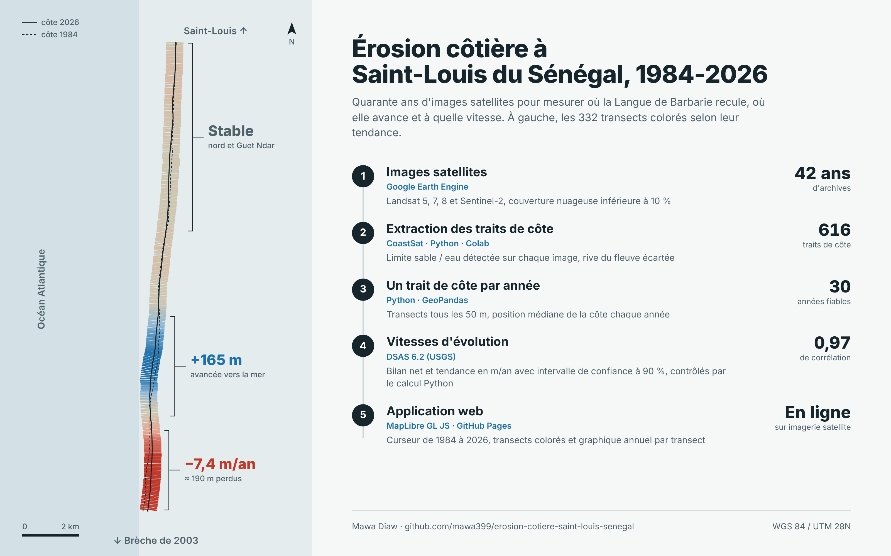

# Érosion côtière à Saint-Louis du Sénégal (1984-2026)

Analyse diachronique du trait de côte de Saint-Louis et de la Langue de Barbarie à partir de 40 ans d'images Landsat et Sentinel-2.

**Application en ligne :** https://mawa399.github.io/erosion-cotiere-saint-louis-senegal/app/

## Vue d'ensemble



## Contexte

La Langue de Barbarie est une flèche sableuse qui sépare le fleuve Sénégal de l'océan Atlantique. En 2003, un canal de délestage y a été creusé pour protéger Saint-Louis des crues du fleuve. Le canal s'est rapidement élargi en brèche, déplaçant l'embouchure du fleuve et faisant disparaître des villages. Le quartier de pêcheurs de Guet Ndar est également exposé à l'avancée de la mer.

Ce projet mesure ces évolutions sur plus de 40 ans.

## Objectifs

1. Extraire automatiquement les traits de côte de 1984 à aujourd'hui
2. Calculer les taux de recul et d'avancée le long de la côte
3. Restituer les résultats dans une application web avec curseur temporel

## Données

| Donnée | Source | Usage |
|---|---|---|
| Landsat 5, 7, 8 | USGS via Google Earth Engine | Traits de côte 1984-2020 (30 m) |
| Sentinel-2 | Copernicus via Google Earth Engine | Traits de côte 2015-2026 (10 m) |

## Méthode

| Étape | Outil | Emplacement |
|---|---|---|
| Extraction des traits de côte (616 dates, 1984-2026) | CoastSat (Python + Google Earth Engine, dans Colab) | `01_extraction_traits_de_cote.ipynb` |
| Un trait de côte médian par année | Transects tous les 50 m, médiane robuste (Python, dans Colab) | `02_traits_annuels.ipynb` |
| Taux d'évolution (NSM, EPR, LRR, WLR) | DSAS 6.2 (application autonome, USGS), IC 90 % | `dsas/` |
| Restitution | Application web MapLibre GL JS | `app/` |

## Résultats DSAS (Langue de Barbarie, 1984-2026)

332 transects tous les 50 m le long d'une ligne de base côté terre, 30 traits annuels fiables, incertitude de 15 m (Landsat) puis 10 m (Sentinel-2).

| Secteur (UTM 28N, nord) | NSM médian | LRR médian |
|---|---|---|
| Sud de la flèche (1758-1762,5 km) | -149 m | -6,4 m/an (±1,7) |
| Centre (1762,5-1766,5 km) | +107 m | +4,1 m/an (±1,2) |
| Centre-nord (1766,5-1769,5 km) | -20 m | -0,2 m/an |
| Nord (1769,5-1773 km) | +48 m | ≈ 0 m/an |
| Guet Ndar (1773-1777 km) | +8 m | -0,7 m/an (±0,6) |

- Recul maximal : NSM -192 m et LRR -7,4 m/an vers 1760,8 km (sud de la flèche)
- Avancée maximale : NSM +165 m vers 1765 km
- 52 % des transects ont un LRR significatif à 90 %, dont 32 % en recul

Contrôle : le NSM de DSAS concorde avec le bilan du notebook 02 (médiane 2022-2026 moins médiane 1984-1990) avec une corrélation de 0,97 et un écart médian de 26 m.

Le segment 1 de la ligne de base (rive sud de l'embouchure, 23 transects) est exclu de l'interprétation : l'embouchure s'y déplace de plusieurs kilomètres.

## Structure

```
erosion-cotiere-saint-louis-senegal/
├── data/
│   ├── aoi/          # Zone d'étude (GeoJSON)
│   ├── raw/          # Images téléchargées (non versionnées)
│   └── processed/    # Traits de côte par date, traits annuels, transects
├── dsas/
│   ├── entrees/      # Ligne de base et traits annuels au format DSAS
│   ├── resultats/    # Transects, intersections et taux (shp, geojson, csv)
│   └── erosion_saint_louis.gpkg   # Projet DSAS 6.2
├── notebooks/        # Notebooks d'analyse
├── outputs/
│   ├── cartes/
│   └── figures/
├── app/              # Application web MapLibre (index.html, app.js, style.css, data/)
└── environment.yml
```

## Exécution

Les notebooks tournent dans **Google Colab** : aucune installation locale, Earth Engine y fonctionne nativement, les images satellites sont stockées sur le disque temporaire de Colab et seuls les résultats sont enregistrés dans Google Drive (`Mon Drive/erosion-cotiere-saint-louis-senegal/`).

1. Ouvrir [Google Colab](https://colab.research.google.com), puis *Fichier > Importer le notebook* et choisir `notebooks/01_extraction_traits_de_cote.ipynb`
2. Renseigner le nom du projet Earth Engine dans la première cellule
3. Exécuter les cellules dans l'ordre : le notebook monte le Drive, installe CoastSat et se connecte à Earth Engine

Un compte Google Earth Engine et un projet Google Cloud enregistré pour l'usage non commercial sont nécessaires.

Pour une exécution locale, le fichier `environment.yml` décrit l'environnement conda équivalent (CoastSat à cloner à la racine du projet).

## Application web

L'application `app/` affiche les traits de côte annuels sur l'imagerie satellite avec un curseur temporel, colore chaque transect selon son taux DSAS (tendance ou bilan net) et montre, au clic, la position de la côte année par année.

Pour la lancer en local : `cd app` puis `python -m http.server 8000`, et ouvrir http://localhost:8000. Elle est publiée sur GitHub Pages (lien en haut de page).

## Système de coordonnées

Les résultats sont produits en WGS 84 / UTM zone 28N (EPSG:32628), adapté au Sénégal.

## Auteur

Mawa Diaw, géomaticien et développeur SIG
[LinkedIn](https://www.linkedin.com/in/mawa-diaw) · [GitHub](https://github.com/mawa399)
